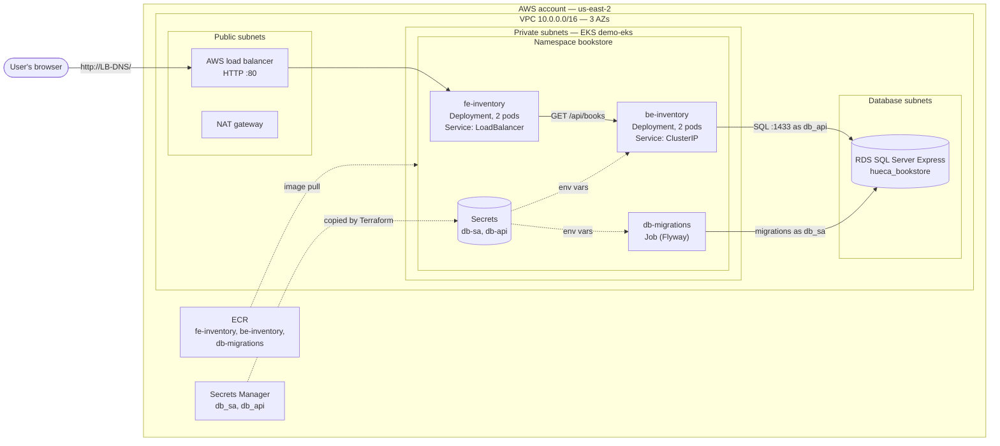
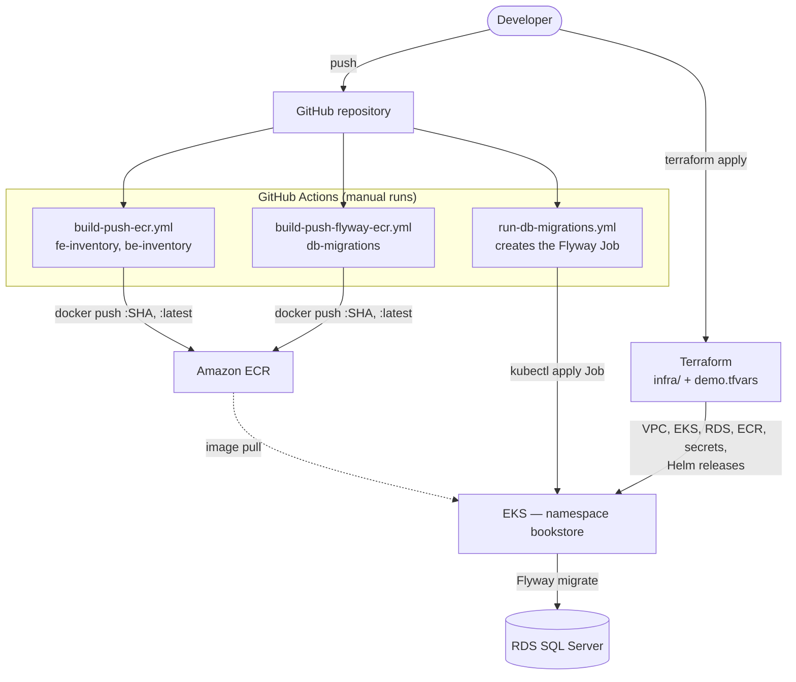
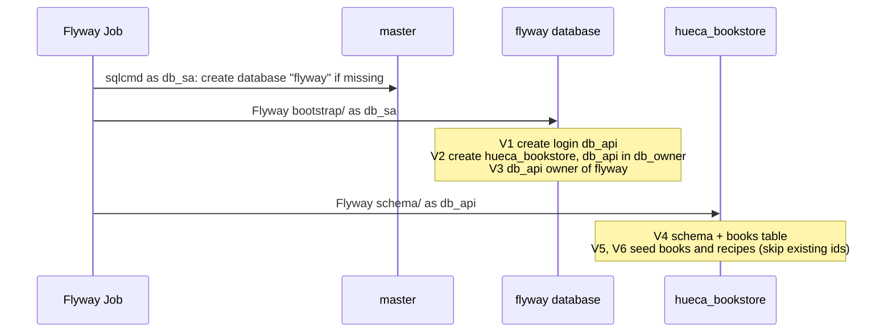

# aws-devops-test-demo — Hueca Bookstore on EKS

A small two-tier web app (**Hueca Bookstore**) deployed on **AWS EKS** with an **RDS SQL Server** database, built entirely with **Terraform**, **Helm**, **Docker** and **GitHub Actions**. No AWS resource is created by hand.

- The **frontend API** (`fe-inventory`) is public, behind an AWS load balancer.
- The **backend API** (`be-inventory`) and the **database** are private; only the cluster can reach them.
- **Schema changes** are versioned SQL scripts, applied by a **Flyway** Kubernetes Job.

---

## Contents

1. [User story](#user-story)
2. [Architecture](#architecture)
3. [Repository layout](#repository-layout)
4. [Design decisions](#design-decisions)
5. [How to deploy](#how-to-deploy)
6. [Run locally](#run-locally)
7. [Using generative AI](#using-generative-ai)
8. [Known limitations and next steps](#known-limitations-and-next-steps)

---

## User story

> As a collector of Ecuadorian dish recipes gathered from small restaurants (*huecas*) and books, I want to publish my recipes and books list, so that anyone on the internet can contact me to trade them (buy, sell, rent).

**Acceptance criteria**

- **Given** a link to the site's recipe list,
- **when** I click that link,
- **then** I see the title, author, price, stock and availability of my books and recipes, and the contact email.

### Epic: tasks

#### Phase 1 — Infrastructure and a first app

- [x] Deploy the infrastructure
  - [x] VPC (public, private and database subnets in 3 AZs)
  - [x] EKS cluster and managed node group
  - [x] ECR repositories
- [x] Deploy the web app
  - [x] Two hello-world APIs: `fe-inventory` (frontend) and `be-inventory` (backend)
  - [x] Show a list of mock books
  - [x] Dockerfiles for both APIs
  - [x] GitHub Action to build the images and push them to ECR
  - [x] Helm chart and Terraform to deploy both APIs on EKS

#### Phase 2 — Persistent data

- [x] Deploy the infrastructure
  - [x] RDS SQL Server instance in the private database subnets
  - [x] Database credentials in AWS Secrets Manager, copied into Kubernetes secrets
  - [x] Flyway migration image (`db-migrations`) and a GitHub Action to push it to ECR
  - [x] GitHub Action that runs the migrations as an EKS Job
- [x] Deploy the web app
  - [x] SQL scripts to create the database, logins and tables, and to load the books and recipes
  - [x] `be-inventory` reads the list from the database
  - [x] Welcome page with a "See available books" link
- [x] Show the contact email on the list page

---

## Architecture

### Runtime: what serves a request



**Request path:** the browser reaches the load balancer, which forwards to the `fe-inventory` pods. The frontend calls `be-inventory` through its internal Service name (`http://be-inventory:8000`), and the backend queries `hueca_bookstore.books` in RDS.

**What is reachable from where:**

| Component | Reachable from | How it's enforced |
|---|---|---|
| `fe-inventory` | Internet | `type: LoadBalancer` Service in the public subnets |
| `be-inventory` | Inside the cluster only | `type: ClusterIP` Service |
| RDS SQL Server | EKS nodes only | Private database subnets, `publicly_accessible = false`, and a security group that allows port 1433 only from the node security group |

### Delivery: how code reaches the cluster



### Database migrations

The Flyway Job ([migrate.sh](hueca-bookstore/sqlcode/migrate.sh)) runs in three steps, because the database it migrates doesn't exist on the first run:



RDS doesn't let the master login create objects in `master`, so the bootstrap migration history is kept in a small `flyway` database.

---

## Repository layout

```
.
├── infra/                          # Terraform: everything on AWS
│   ├── main.tf                     # Wires the modules together
│   ├── variables.tf                # Typed, validated inputs
│   ├── demo.tfvars                 # Values for the "demo" environment
│   ├── providers.tf, versions.tf, outputs.tf
│   └── modules/
│       ├── vpc/                    # terraform-aws-modules/vpc
│       ├── eks/                    # terraform-aws-modules/eks, access entries, add-ons
│       ├── rds-sqlserver/          # RDS SQL Server Express + security group
│       ├── secrets/                # Secrets Manager + Kubernetes secrets
│       ├── ecr/                    # Repositories, scan on push, lifecycle policy
│       └── k8s-service/            # Helm release of the local chart below
│           └── chart/              # Deployment + Service for one web service
├── hueca-bookstore/
│   ├── fe-inventory/               # Frontend API (FastAPI) + Dockerfile
│   ├── be-inventory/               # Backend API (FastAPI, SQL Server) + Dockerfile
│   ├── requirements.txt            # Python dependencies for both APIs
│   └── sqlcode/                    # Flyway image
│       ├── Dockerfile, migrate.sh
│       ├── bootstrap/              # V1–V3: login, database, permissions (as db_sa)
│       ├── schema/                 # V4+: tables and data (as db_api)
│       └── k8s/db-migrations-job.yaml
├── .github/workflows/
│   ├── build-push-ecr.yml          # Build and push fe-inventory, be-inventory
│   ├── build-push-flyway-ecr.yml   # Build and push db-migrations
│   └── run-db-migrations.yml       # Run the Flyway Job on EKS
├── deploy-infra-claude.md          # AI session log: infrastructure
└── deploy-webapp-code-claude.md    # AI session log: app, Docker, SQL, CI
```

---

## Design decisions

### Terraform

- **One root, one tfvars file per environment.** `infra/` is the root module, and every environment-specific value (CIDRs, AZs, instance sizes, services, secrets) lives in `<env>.tfvars`. Adding `dev` or `prod` means adding `dev.tfvars` / `prod.tfvars`, with no code changes. See [next steps](#known-limitations-and-next-steps) for separate state per environment.
- **Small local modules around community modules.** `vpc/` and `eks/` wrap the well-maintained `terraform-aws-modules` and expose only the inputs this project needs. The other modules (`rds-sqlserver`, `secrets`, `ecr`, `k8s-service`) are small and written here.
- **Typed, validated inputs.** Variables are `object(...)` types with `optional(...)` defaults. `validation` blocks catch mistakes before `apply`, for example EKS and RDS each need subnets in at least two AZs, and `rds.master_secret` must name a defined secret.
- **Subnets chosen by type or name.** EKS and RDS select subnets with `subnets = "private"` or `"db_private"`, rather than listing CIDRs twice.
- **Explicit dependency order.** Namespace, then secrets, then RDS, then Helm services. This way a pod never starts before the secret it reads exists.

### Kubernetes and Helm

- **One reusable chart** ([k8s-service/chart](infra/modules/k8s-service/chart)) for both APIs, installed by Terraform's Helm provider. Each service sets replicas, port, public or private, plain env vars and env vars from secrets (`secret_env`) in the tfvars.
- **Security defaults:** containers run as a numeric non-root UID (`runAsNonRoot: true`), with `allowPrivilegeEscalation: false`, CPU and memory requests, and a memory limit.
- **Health checks:** readiness and liveness probes on `/openapi.json`. That endpoint doesn't touch the database, so a database outage returns 503s but doesn't restart pods.
- **Migrations as a Job, not at app start-up.** Schema changes run once per release, serialized by the workflow's `concurrency` group, instead of on every pod start.

### Security

- **Generated passwords.** Terraform generates both database passwords, stores them in **AWS Secrets Manager** (the source of truth), and copies them into Kubernetes secrets. No password is in the repository.
- **Least privilege for the database.** The API connects as `db_api`, owner of `hueca_bookstore` only. The admin login `db_sa` is used only by the migration Job.
- **Network isolation.** Only the frontend is internet-facing. RDS is in its own subnets and accepts traffic only from the EKS nodes.
- **Encryption and image scanning.** RDS storage is encrypted, and ECR scans each image on push.
- **Scoped CI access.** The GitHub Actions IAM user gets an EKS access entry with `AmazonEKSEditPolicy`, limited to the `bookstore` namespace.

### Cost

This is a demo, so it is sized to be cheap:

- SQL Server **Express** on `db.t3.micro`, single-AZ, with no deletion protection.
- One NAT gateway.
- A small node group (`m7i-flex.large`).
- An ECR lifecycle policy that removes old images.

[Next steps](#known-limitations-and-next-steps) lists what changes for production.

---

## How to deploy

**Prerequisites:** an AWS account, AWS CLI v2, Terraform ≥ 1.9, kubectl, and Helm.

1. **Set AWS credentials** for Terraform (an AWS profile or environment variables).

2. **Create the infrastructure**:

   ```bash
   cd infra
   terraform init
   terraform apply -var-file=demo.tfvars
   ```

   On the first run, the API pods wait for images that don't exist yet (step 4). After step 5, put the RDS endpoint into `be-inventory.env.DB_HOST` in `demo.tfvars` and apply again:

   ```bash
   terraform output rds_endpoint
   ```

3. **Configure GitHub:** in *Settings → Secrets and variables → Actions*, add `AWS_ACCESS_KEY_ID` and `AWS_SECRET_ACCESS_KEY` for the CI IAM user. That user's ARN must be in `eks.deployer_arns` in `demo.tfvars`.

4. **Build and push the images** from the *Actions* tab:
   - **Build and push images to ECR**: `fe-inventory` and `be-inventory`
   - **Build and push Flyway image to ECR**: `db-migrations`

5. **Run the migrations:** *Actions → Run DB migrations on EKS*. Choose an image tag (`latest` or a commit SHA). Check the **repair** box only after fixing a failed script.

6. **Roll out the APIs** so the pods pull the new images:

   ```bash
   kubectl rollout restart deployment/be-inventory deployment/fe-inventory -n bookstore
   ```

7. **Open the site:**

   ```bash
   kubectl get svc fe-inventory -n bookstore \
     -o jsonpath='http://{.status.loadBalancer.ingress[0].hostname}'
   ```

   Open that URL with **http://** (the load balancer has no HTTPS listener). It shows a **Welcome** page, and **See available books** lists the books and recipes from the database.

---

## Run locally

```bash
pip install -r hueca-bookstore/requirements.txt

# Backend: needs a SQL Server with the migrations applied
DB_HOST=localhost DB_USER=db_api DB_PASSWORD='...' \
  uvicorn main:app --app-dir hueca-bookstore/be-inventory --reload --port 8001

# Frontend
BACKEND_API_URL=http://localhost:8001 \
  uvicorn main:app --app-dir hueca-bookstore/fe-inventory --reload --port 8000
```

| Service | Endpoint | Returns |
|---|---|---|
| `fe-inventory` | `GET /` | Welcome page |
| `fe-inventory` | `GET /books` | Books table (HTML) |
| `fe-inventory` | `GET /api/books` | Books (JSON, proxied from the backend) |
| `be-inventory` | `GET /api/books` | Books from `hueca_bookstore.books` (JSON); 503 if the database is down |

Backend settings are environment variables: `DB_HOST`, `DB_PORT` (default `1433`), `DB_NAME` (default `hueca_bookstore`), `DB_USER`, `DB_PASSWORD`.

---

## Using generative AI

The infrastructure and app were built with **Claude Code** inside VS Code, through short, incremental prompts. One prompt per change made each step easy to review. The full sessions, prompts and output, are in:

- [deploy-infra-claude.md](deploy-infra-claude.md): VPC, EKS, services, secrets, RDS, ECR, and the migration Job
- [deploy-webapp-code-claude.md](deploy-webapp-code-claude.md): Dockerfiles, GitHub Actions, frontend pages, Flyway, and the backend database code

**Example prompts:**

```text
Need to deploy an EKS cluster with helm.
```
```text
I will deploy flyway in EKS, so prepare the docker build to generate the image and
include the sql files in it. This service will receive the db_sa creds and the
db_api creds, and the database endpoint.
```
```text
The items in the be-inventory should now be in a database table under the
hueca_bookstore schema with the same structure. The SQL code that does the inserts
should validate that items already exist by id.
```

### How the output was validated

- **Static checks:** `terraform fmt`, `terraform validate` and `terraform plan` before every apply, `helm template` to render the chart, and `sh -n` plus a dry run with a fake `flyway` binary for `migrate.sh`.
- **Local runs:** both APIs run with `uvicorn`, checked with `curl`, including the database-down path, which returns 503 rather than crashing.
- **In AWS:** after each apply, `kubectl get pods,svc` and `describe`, and a request through the load balancer down to the RDS data.

### What had to be corrected

| Problem found | Fix |
|---|---|
| Pods failed: `runAsNonRoot` and an image with a **named** user (`USER appuser`) | Numeric UID in the Dockerfiles (`USER 10001:10001`) |
| OIDC role for GitHub Actions not possible on the free account | Switched to a dedicated IAM user's access keys, with ECR-only permissions |
| SQL Server rejects `CREATE DATABASE` / `CREATE LOGIN` inside a transaction | Flyway script config files with `executeInTransaction=false` |
| RDS master login can't create objects in `master` (Flyway history) | Separate `flyway` database for the bootstrap history |
| A password containing `'` could break the `CREATE LOGIN` statement | Single quotes are escaped before the password reaches Flyway |
| A cycle: secrets waited for the Helm namespace, and services needed the secrets | Namespace managed by Terraform (existing namespace imported once) |
| x86 nodes, Apple Silicon laptop | Images built with `--platform linux/amd64` |

---

## Known limitations and next steps

**Not production-ready yet:**

- **Terraform state is local.** Next: an S3 backend with locking, and one state per environment (workspaces, or one root per environment).
- **CI uses long-lived access keys.** Next: GitHub OIDC with an IAM role.
- **No HTTPS.** The site is HTTP only, behind a Classic load balancer. Next: AWS Load Balancer Controller, an Ingress with an ALB, and an ACM certificate.
- **`DB_HOST` is copied into `demo.tfvars` by hand**, and must be updated if the RDS instance is recreated.
- **Deploys and the cluster API are open.** The image workflows push `latest` and pods restart by hand, and the EKS API endpoint is public. Next: deploy by commit SHA from CI, or GitOps with Argo CD.
- **RDS is single-AZ with no deletion protection.** For production: Multi-AZ, deletion protection, final snapshot, and a longer backup retention.
- **No observability yet.** Next: CloudWatch Container Insights or Prometheus and Grafana, logs to CloudWatch, alerts on 5xx errors and pod restarts, and a HorizontalPodAutoscaler.
